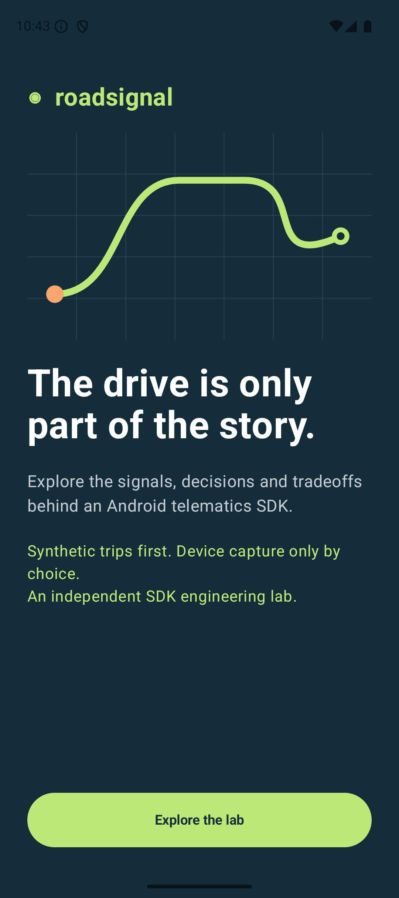
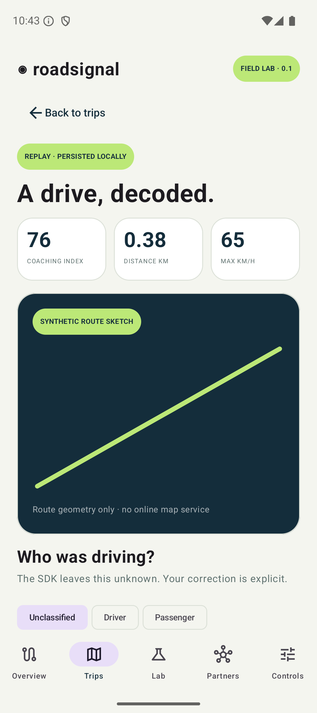
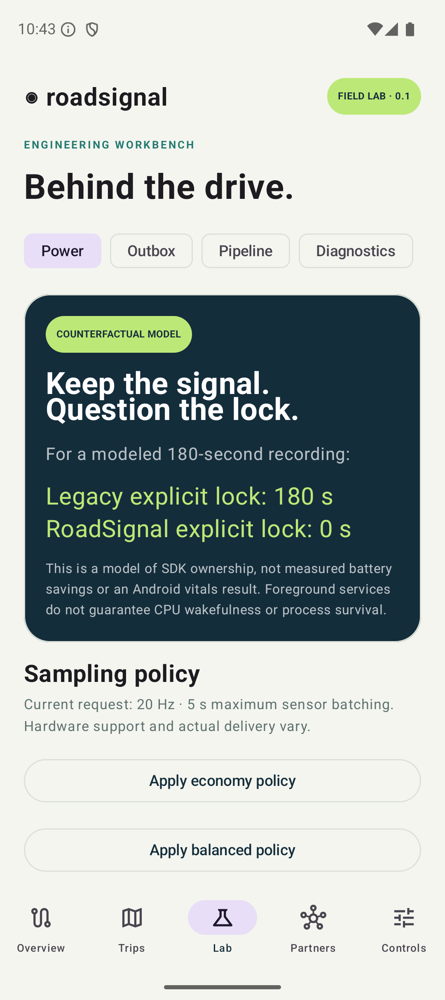
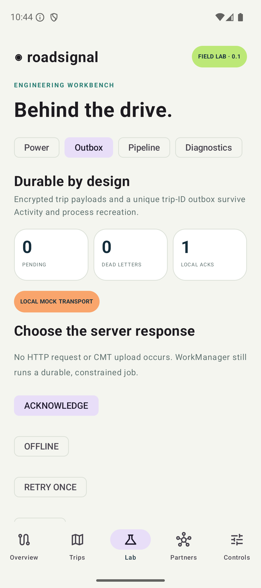
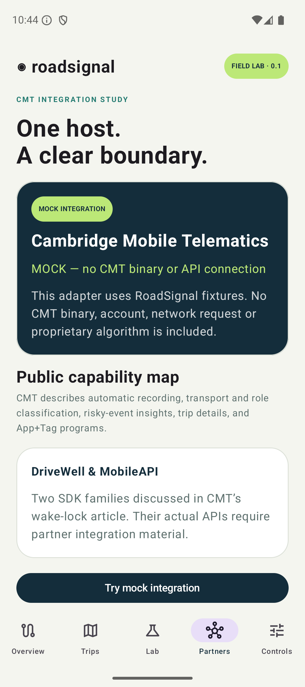
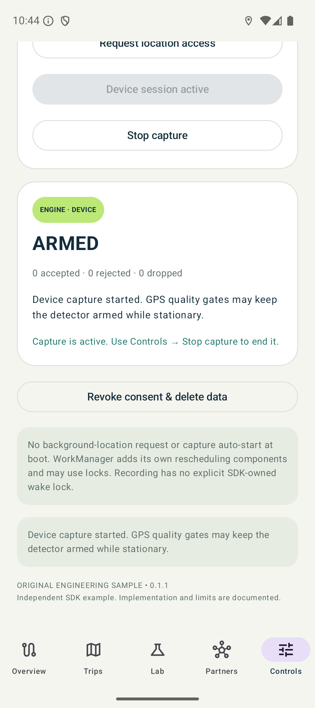
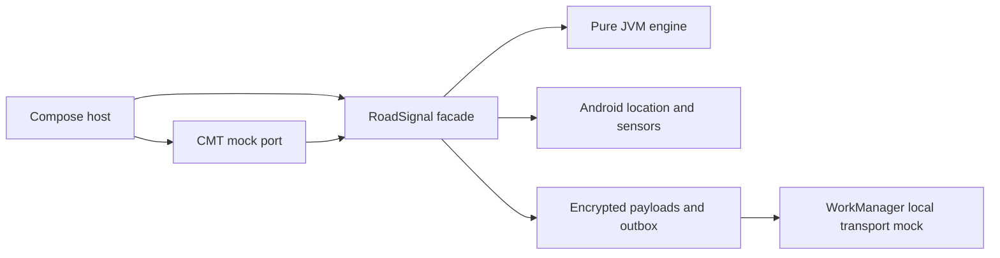

# RoadSignal Lab

**An Android telematics SDK you can inspect, run, publish and consume.** A Kotlin/Compose host integrates an original SDK and a clearly labeled CMT mock adapter. An exploration of SDK integration, sensor capture and client distribution, with public-source research reviewed **November 4, 2026**.

[Prototype release](https://github.com/phillipsk/RoadSignalLab/releases/tag/v0.1.1) · [Getting started](docs/START_HERE.md) · [Engineering report](docs/README.md) · [Portable HTML](docs/engineering-report.html) · [SDK APIs](docs/SDK_API.md) · [Distribution](docs/DISTRIBUTION.md) · [Evidence](docs/VERIFICATION.md)

> **Scope:** RoadSignal is an original educational prototype, not CMT software. Default trips are synthetic. No sanctioned CMT Android artifact/API guide was verified in the public research, so the vendor integration is mocked and unavailable real setup fails explicitly. Coaching and impact candidates are unvalidated heuristics. No emergency service, real upload, battery-savings result or CMT performance claim is implied.

## Run it

Open this directory in Android Studio, use JDK 21 for Gradle, and run **sample-app** on Android 8+ (API 26+). The tested build uses Gradle 8.13, AGP 8.13.2, Kotlin 2.3.10, compile/target SDK 36 and Java 17 bytecode. Versions are deliberately pinned rather than automatically tracking latest releases.

```sh
./gradlew :sample-app:assembleDebug
```

Choose **Explore the lab → Controls → Enable local SDK → Overview → Replay commute → Trips**. The synthetic walkthrough needs no API key, account, location permission or internet endpoint. Device capture is a separate explicit start with foreground location permission.

## See the journeys

<table><tr>
<td><br><sub>Independent SDK lab</sub></td>
<td><br><sub>Synthetic trip + coaching</sub></td>
<td><br><sub>Power ownership model</sub></td>
</tr><tr>
<td><br><sub>Durable local mock delivery</sub></td>
<td><br><sub>Explicit CMT mock boundary</sub></td>
<td><br><sub>Actual device-service lifecycle</sub></td>
</tr></table>

[All 18 native screenshots and captions](docs/SCREENSHOT_GALLERY.md) · [16 reproducible journeys](docs/USER_JOURNEYS.md)


## Modules and ownership

| Module | What it demonstrates |
| --- | --- |
| [telematics-core](telematics-core/src/main/kotlin/io/roadsignal/core) | Android-free trip reducer, monotonic/quality gates, hysteresis, replay, retry/policy decisions |
| [telematics-sdk](telematics-sdk/src/main/java/io/roadsignal/sdk) | Consent-gated facade, bounded concurrency, actual location FGS and sensor listeners, encrypted finalized trips, local-only durable outbox |
| [cmt-bridge](cmt-bridge/src/main/java/io/roadsignal/cmt) | Original mock integration port; unavailable licensed-vendor path |
| [sample-app](sample-app/src/main/java/io/roadsignal/app) | Compose host, permissions/consent, journal, event timeline, engineering workbench |
| [distribution-consumer](distribution-consumer) | Separate app compiled and shrunk against actual published Maven artifacts |



## SDK engineering features

- Explicit application-scoped setup; no sensing on construction or consent grant.
- User-started location foreground service, notification Stop action, owned sensor thread, cleanup, missing-permission/start failure handling and no automatic boot restart.
- GPS/provider speed, linear acceleration and gyroscope input; requested sampling/batching profiles with capability inspection and honest hardware limitations.
- Conservative trip start/stop, invalid/poor/out-of-order sample rejection, gap segmentation, bounded route/event history and explicit replay/device provenance.
- Off-main disk/crypto work; a single-writer engine, bounded channel, generation fences and durable consent epochs.
- Android Keystore/AES-GCM trip payloads, atomic trip/outbox writes, non-destructive migration fixture, finite retry/dead-letter states and local receipt deduplication.
- Policy revision/TTL admission and disable control using a local fixture; no deployed remote server.
- Kotlin state flow and a Java callback adapter; core ABI and Android/bridge descriptor baselines.
- AAR/JAR/POM/module metadata/source publication and a separate external-dependency consumer, plus pinned CI, checksums and a tag-only provenance job.

See [implemented versus proposed](docs/IMPLEMENTATION_STATUS.md) before presenting any feature. Finalized trips survive restart; active partial capture is not checkpointed. The current SDK is single-process, and role corrections are local. No validated distraction, automatic driver classification, BLE Tag protocol, cloud scoring or continuous low-power trip discovery is included.

## Build, verify and distribute

```sh
scripts/verify.sh
scripts/distribute.sh
# With one emulator attached and adb on PATH; resets this lab's fixture data:
scripts/instrumented.sh
```

The contained Maven repository is generated under `build/maven-repository`. The distribution ZIP/checksums/unsigned local manifest are under `build/distribution`. The consumer build must resolve all three RoadSignal components from Maven metadata, not project dependencies. The release pipeline produces an SDK ZIP and debug APK with checksums and build provenance. Local build/API/lint/published-consumer checks pass; see [verification](docs/VERIFICATION.md) for current run results and scope.

## Engineering exploration

The [source ledger](docs/RESEARCH.md) connects public telematics material with Android constraints and SDK distribution practices. [Power/reliability](docs/POWER_AND_RELIABILITY.md), [privacy](docs/DATA_AND_PRIVACY.md), and [release adoption](docs/RELEASE_PLAYBOOK.md) explain the design choices and remaining work.

[AGENTS.md](AGENTS.md) and [CLAUDE.md](CLAUDE.md) describe the build commands, compatibility rules and evidence boundaries for repository tooling.
