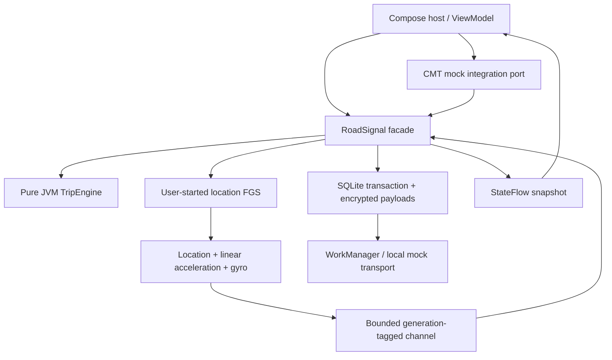
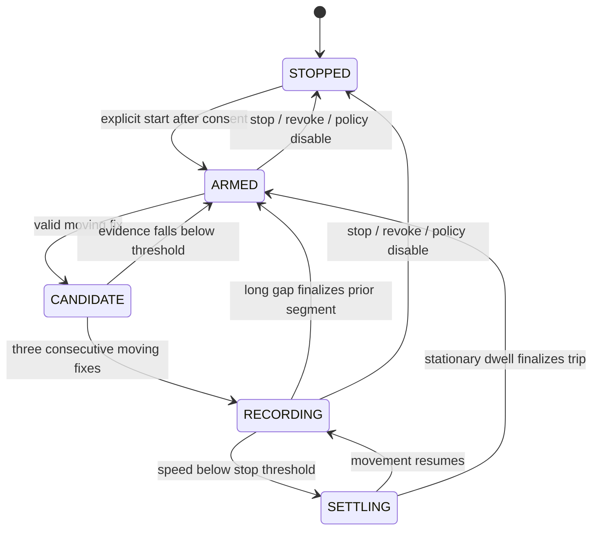

# Architecture and execution model

## Boundaries

`telematics-core` has no Android, coroutine, location-service or network dependencies. It accepts copied immutable samples and produces deterministic state transitions and finalized summaries. `telematics-sdk` owns execution and resources. The host owns presentation, permission prompts and visible user choices. `cmt-bridge` is a replaceable partner boundary. Distribution consumers receive core transitively via the AAR's published API dependency.

## State and timing

Samples use elapsed milliseconds derived from `Location.elapsedRealtimeNanos` or synthetic replay time; sensor callbacks use the corresponding elapsed clock. Wall-clock changes cannot alter trip duration or acceleration calculations. Trip confirmation deliberately starts at the confirmation fix, not the first candidate, so pre-confirmation distance is omitted. A long gap closes the previous trip at the last accepted fix. No distance is invented across the gap. Stationary dwell tolerates traffic lights; it is not a production-trained transport classifier.

Policies are validated against revision and absolute TTL at application. The Android facade converts remaining policy TTL to an elapsed-time deadline and schedules one expiry action for an active collection; later wall-clock adjustments cannot extend an active policy. Configuration is not persisted, remotely authenticated or targeted. A production control plane needs signed payloads, capability/version gating, a last-known-good strategy, persisted expiry semantics and audited targeting.

## Concurrency and ownership

The application-scoped facade retains only application context. Public suspending mutations move disk/crypto work onto `Dispatchers.IO`, then acquire a single-writer `Mutex`. The engine is never accessed concurrently. The scope uses a supervisor and bounded error reporting. `StateFlow` gives consumers the latest state; it is not an event-delivery guarantee or durable event bus.

Hardware callbacks run on one owned `HandlerThread`. They copy values, aggregate bounded linear/gyro peaks and offer location-timestamped samples into a 64-element channel. Overflow increments a counter instead of allocating unbounded work. A collection-generation tag fences callbacks left over from a stopped/replaced capture. Consent has a separate durable epoch: an asynchronous producer cannot save a trip after revocation under the old epoch. Those are different lifetimes and require different guards.

The service is non-exported, started by visible host UI, uses the location FGS type and posts a Stop notification. It is not sticky, stops with the task, and does not start at boot. Listener registrations and the handler thread are released on stop/destruction. A process death does not auto-resume capture. Availability is a product contract, not a reason to silently bypass platform rules.

## Persistence and recovery

Finalizing a trip inserts its encrypted summary and outbox ID in one SQLite transaction. Schema v2 adds a capture-wall-time column; an instrumented v1 fixture verifies a non-destructive migration. Payload schema v1 is independent of database schema and SDK SemVer. Unsupported migrations fail; the SDK does not delete and recreate user data.

AES-GCM encrypts payload columns with an Android Keystore key. Primary IDs, sequence numbers, timestamps, consent state, retry state and counts remain SQLite metadata. It is not whole-database encryption. The store surfaces unreadable ciphertext records rather than rendering plaintext or claiming successful recovery.

Only finalized trips are durable. The current engine does not checkpoint an active partial trip. The cold-process test checks that finalized journal/outbox state reloads and capture remains stopped. Production crash recovery would need encrypted segment checkpoints, restart reconciliation and a reviewed policy for incomplete trips.

## Extension seams

- Replace the mock transport behind an explicit authenticated upload contract, with payload revisions and server idempotency.
- Implement a licensed CMT adapter only after receiving exact supported vendor APIs and redistribution terms.
- Introduce low-power discovery as a separate platform component, with Activity Recognition or other justified triggers and explicit permission/policy handling.
- Upgrade peak features to calibrated, timestamp-aligned sensor windows; account for phone orientation, mounts, missing gyros and sample-rate variation.
- Add backend model/version provenance and confidence intervals before making any behavioral risk claim.
- Support multi-process hosts through a central broker or interprocess-safe ownership model; process-local mutexes are insufficient.
