# Native screenshot gallery

These are unaltered Android emulator screenshots from passing instrumented journeys. Synthetic, modeled, local-mock and actual device-service behavior are distinguished in every caption. No physical drive or energy measurement is implied.

[Journey guide](USER_JOURNEYS.md) · [Capture manifest](screenshots/capture-manifest.json)

## 01 · Welcome to the independent lab

**Mode:** presentation.

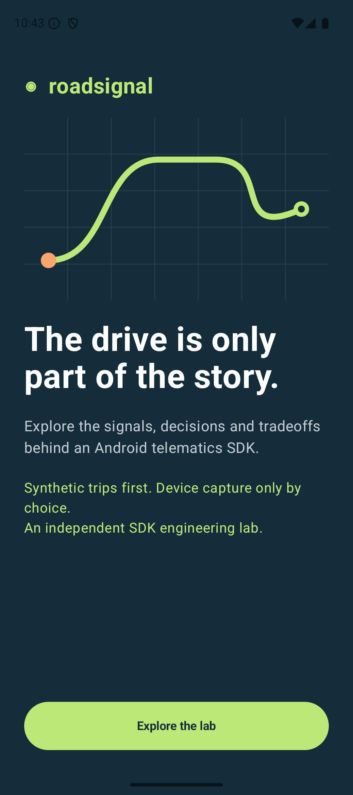

## 02 · Explore before consenting

**Mode:** consent-gate.

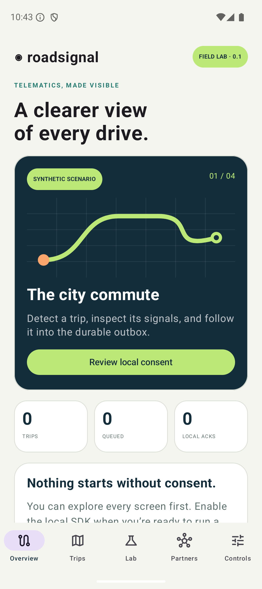

## 03 · Consent and a separate device-start choice

**Mode:** local-consent.

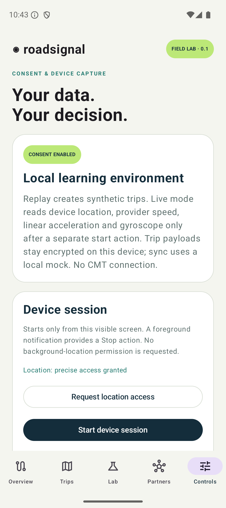

## 04 · A persisted synthetic trip

**Mode:** synthetic.

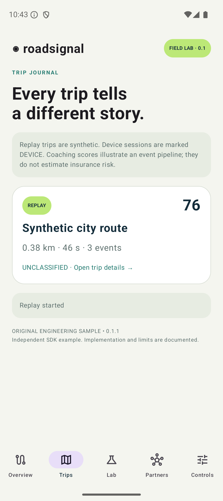

## 05 · Route, distance and illustrative coaching

**Mode:** synthetic.

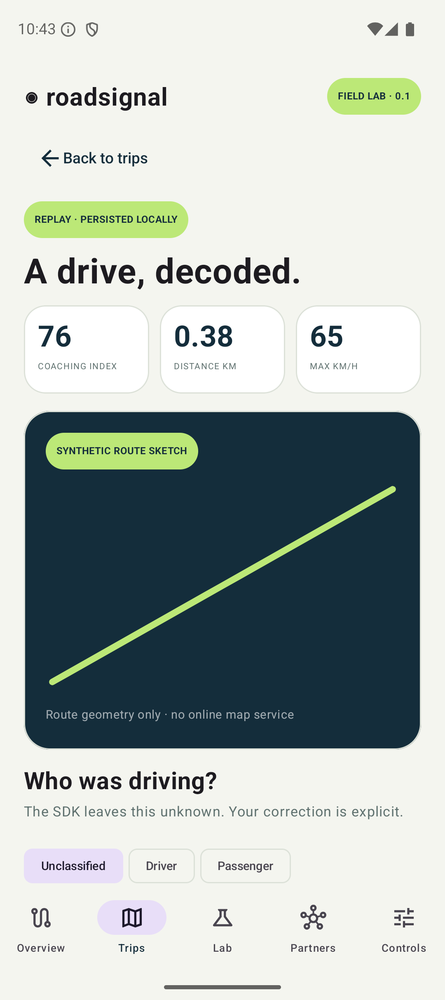

## 06 · Events and explicit user role correction

**Mode:** synthetic.

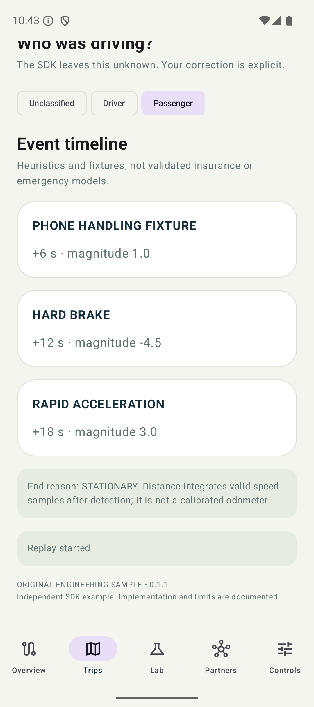

## 07 · Counterfactual lock ownership; no battery measurement

**Mode:** modeled.

## 08 · Local sampling-policy controls

**Mode:** local-policy.

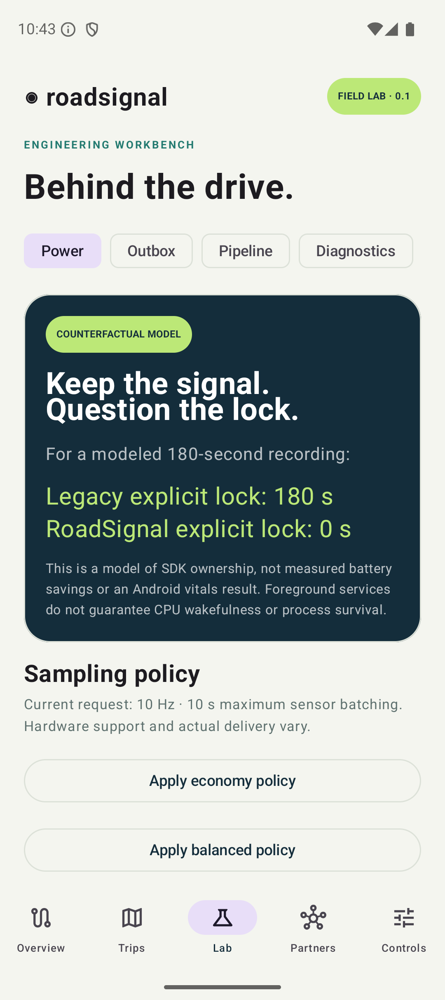

## 09 · Queued local mock delivery

**Mode:** local-mock.

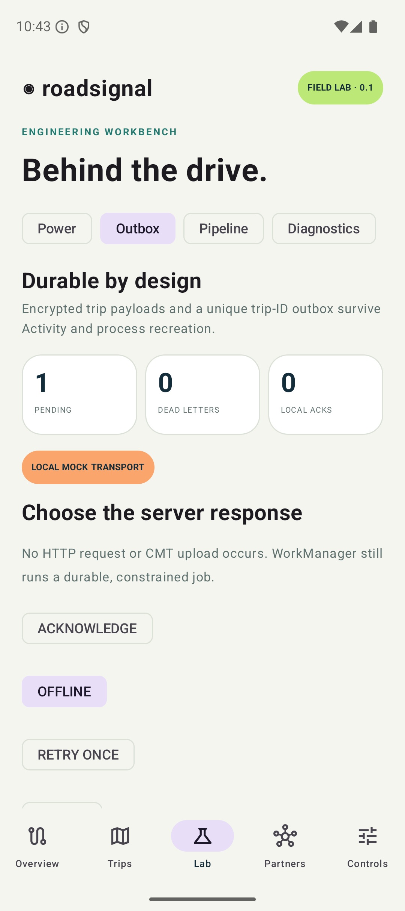

## 10 · Durable local acknowledgment

**Mode:** local-mock.

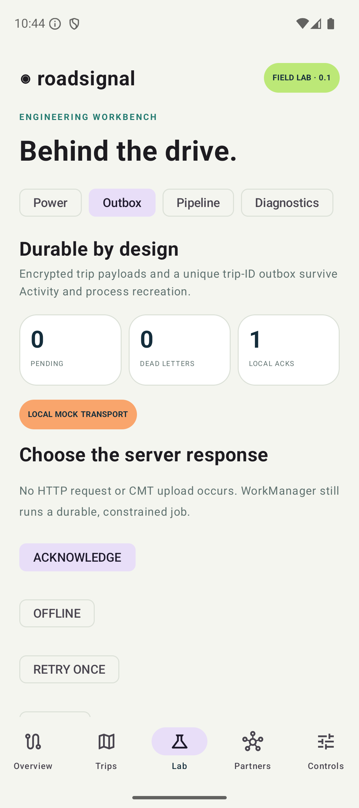

## 11 · Contained artifact lifecycle

**Mode:** presentation.

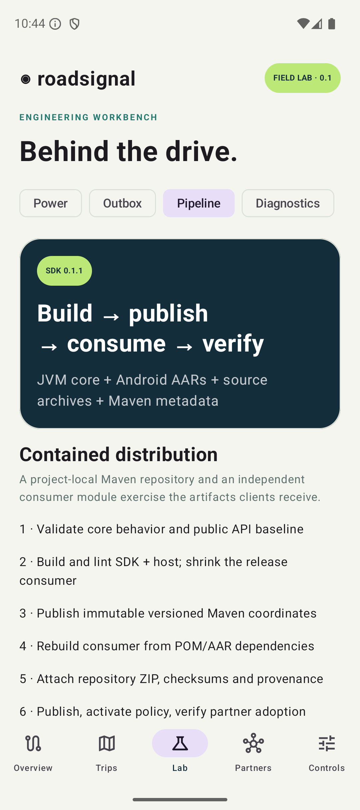

## 12 · Mock and unavailable vendor boundaries

**Mode:** cmt-mock.

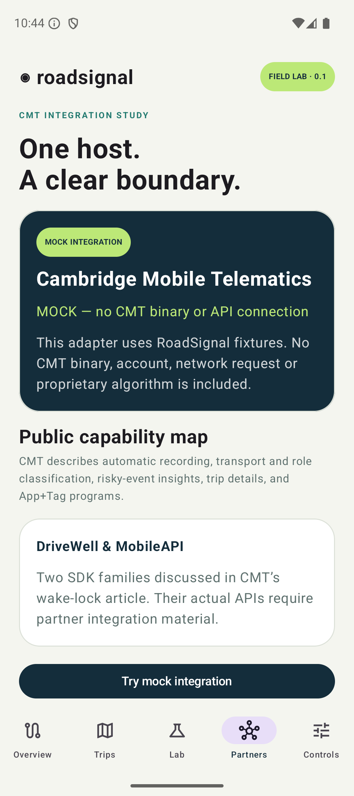

## 13 · Bad GPS rejection and long-gap segmentation

**Mode:** synthetic.

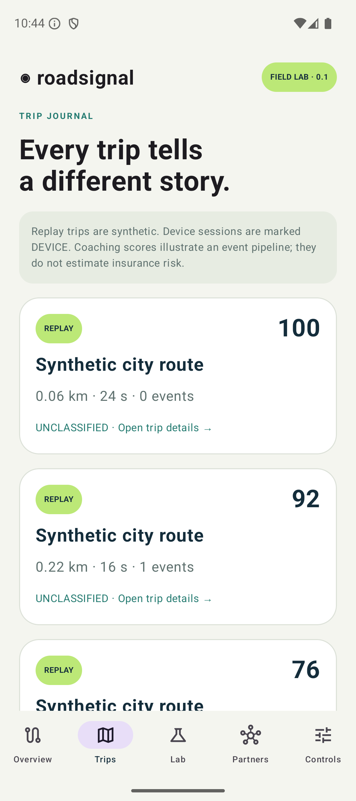

## 14 · Synthetic impact candidate, no emergency action

**Mode:** synthetic.

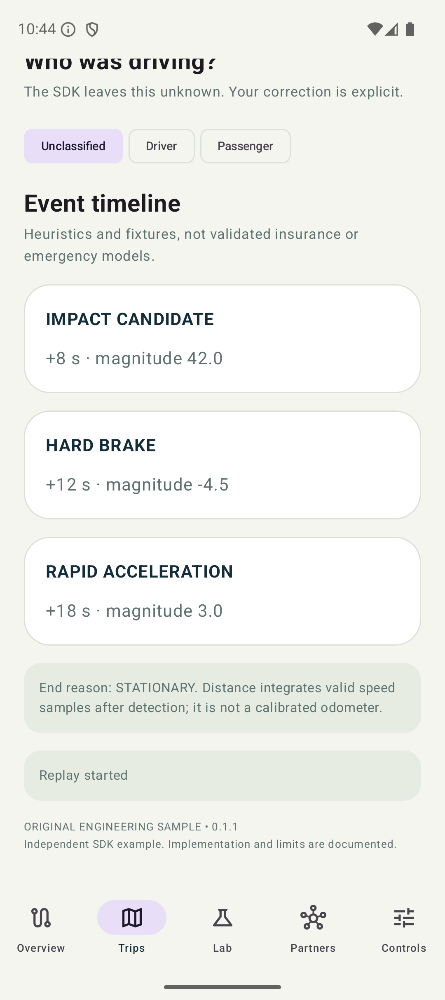

## 15 · Bounded diagnostics and hardware capability data

**Mode:** local-diagnostics.

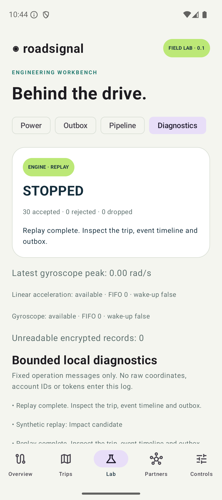

## 16 · Actual foreground service; no physical-drive quality claim

**Mode:** device-service-lifecycle.

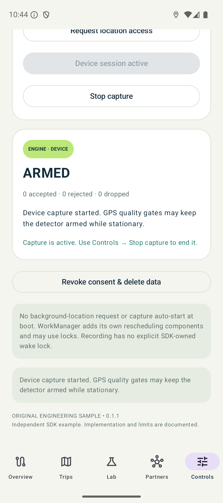

## 17 · Confirm local deletion

**Mode:** local-privacy.

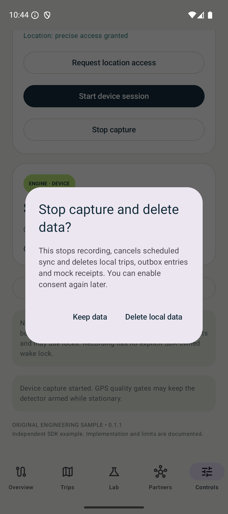

## 18 · Consent disabled and local state cleared

**Mode:** local-privacy.

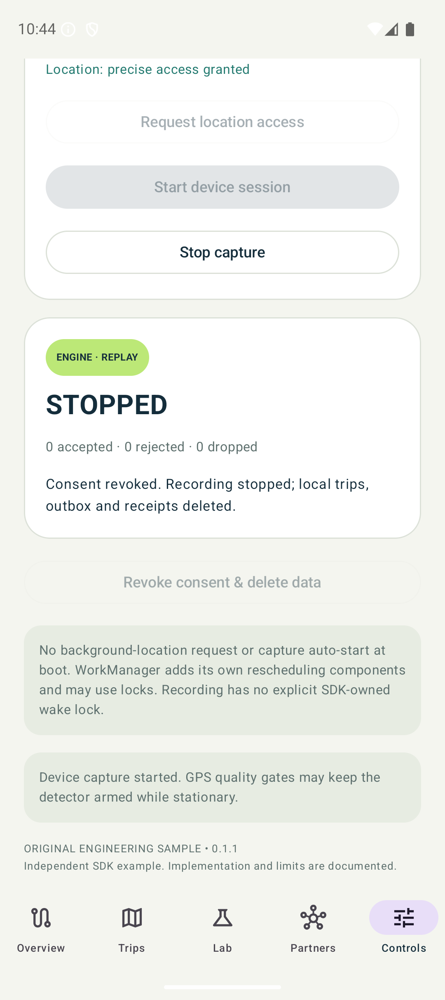
